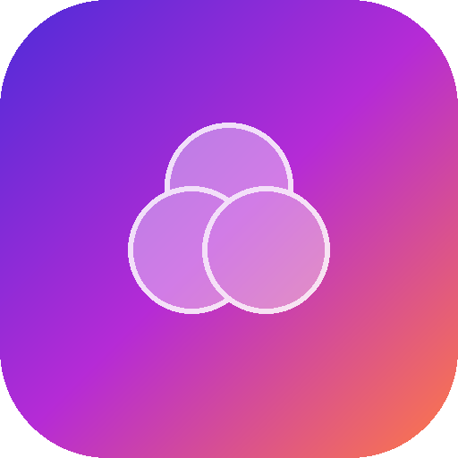
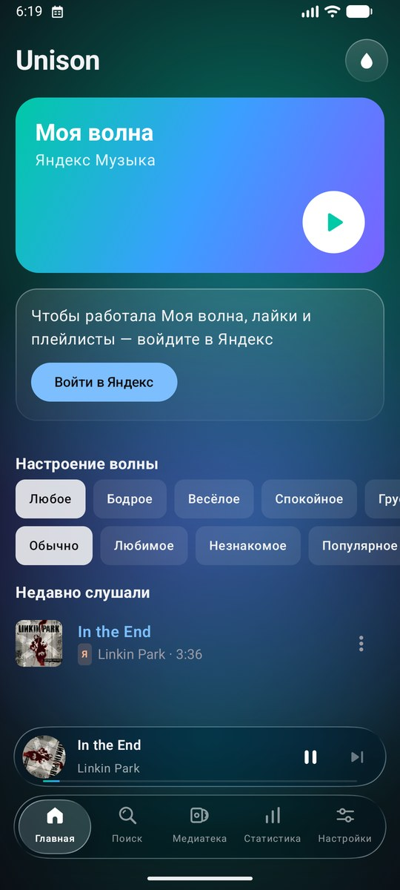
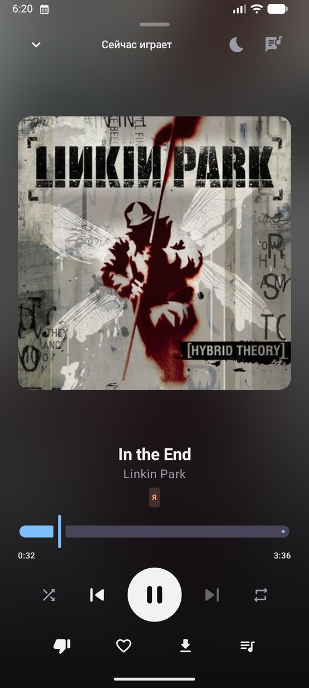
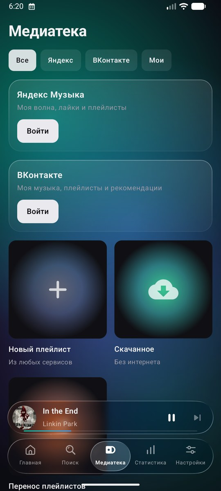
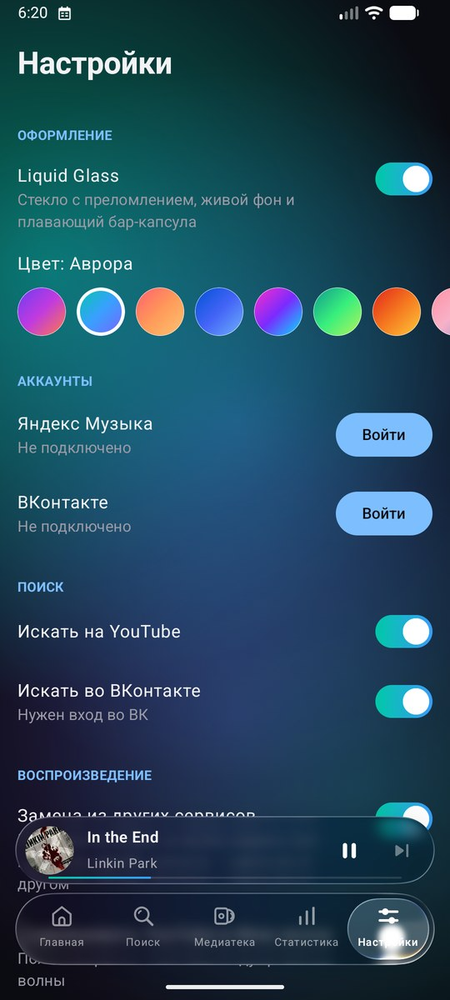
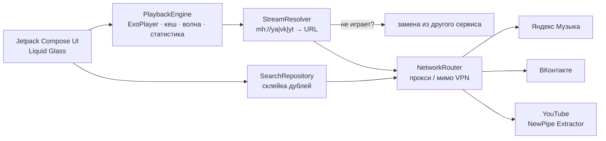

<div align="center">



# Unison

**Яндекс Музыка, ВКонтакте и YouTube — в одном плеере.**<br/>
Моя волна, единый поиск, офлайн, синхронные тексты и Liquid Glass.

[](https://github.com/Vexorter42/Unison/releases/latest)
[](https://github.com/Vexorter42/Unison/releases)


[](LICENSE)

[**⬇ Скачать APK**](https://github.com/Vexorter42/Unison/releases/latest) · [Возможности](#-возможности) · [Установка](#-установка) · [VPN и Happ](#-vpn-и-happ) · [Сборка](#-сборка-из-исходников)

<br/>

<table>
  <tr>
    <td></td>
    <td></td>
    <td></td>
    <td></td>
  </tr>
  <tr align="center">
    <td><sub><b>Моя волна</b></sub></td>
    <td><sub><b>Плеер</b></sub></td>
    <td><sub><b>Медиатека</b></sub></td>
    <td><sub><b>11 палитр</b></sub></td>
  </tr>
</table>

</div>

---

## ✨ Возможности

| | |
|---|---|
| 🌊 **Моя волна** | Рекомендации Яндекса с настроением и характером. Лайки и пропуски уходят в Яндекс и учат волну |
| 🔎 **Единый поиск** | Ищет сразу в Яндексе, ВК и на YouTube. Один и тот же трек склеивается в одну строку — с значками `Я` `VK` `YT` |
| 🔁 **Умная замена** | Нет подписки, трек удалён или недоступен в регионе — играет копия из другого сервиса |
| 🎛 **Микс в волне** | По желанию подмешивает похожие треки с YouTube в Мою волну |
| 📚 **Свои плейлисты** | Треки из любых сервисов в одном плейлисте + плейлисты Яндекса и ВК |
| ↔️ **Перенос** | Плейлист YouTube или ВК → новый плейлист в Яндекс Музыке |
| 📴 **Офлайн** | Авто-кеш прослушанного и «Скачать» трек или плейлист целиком |
| 🎤 **Тексты** | Синхронные тексты песен с автопрокруткой, тап по строке — перемотка |
| 📊 **Статистика** | Минуты, топ треков и исполнителей, откуда музыка, в какое время слушаете, «Итоги года» |
| 🛠 **Мелочи** | Плавные переходы, таймер сна, эквалайзер, выбор качества, управление с экрана блокировки |
| 🔄 **OTA** | Приложение само находит новую версию на GitHub и обновляется |

### 💧 Liquid Glass

Тема в духе iOS 26 — включается одной кнопкой-каплей на главной:

- **настоящее стекло** с преломлением и бликами у плавающего бара и мини-плеера — сквозь них видно контент;
- **пузырь-индикатор** в баре перетекает между вкладками: в полёте вытягивается, на месте «оседает» пружиной;
- **переключатели-капли**: при нажатии бегунок раздувается и становится прозрачной линзой;
- **живой фон** из медленно плавающих цветных пятен, **11 палитр** на выбор;
- плеер **смахивается вниз** в мини-плеер, обложка в мини-плеере крутится как пластинка.

Дизайн вдохновлён [Liner](https://github.com/tryliner/desktop): цвет экрану даёт обложка, а вся обвязка — нейтральное стекло.

## 📲 Установка

1. Скачайте `Unison-x.y.z.apk` из [последнего релиза](https://github.com/Vexorter42/Unison/releases/latest).
2. Откройте файл на телефоне и разрешите установку из этого источника.
3. Настройки → **Аккаунты** → войдите в Яндекс и/или ВКонтакте.

Дальше обновления приходят сами: приложение раз в 12 часов проверяет GitHub Releases и предлагает обновиться (или вручную: Настройки → Обновления → «Проверить»).

> **Яндекс Музыка:** полные треки — с подпиской Плюс. Без неё Яндекс отдаёт превью, и Unison автоматически играет трек с YouTube.
>
> **ВКонтакте:** вход идёт от имени клиента Kate Mobile — иначе VK не отдаёт музыку. В окне «Войти через приложение» выберите **«Ввести данные вручную»**.

## 🛡 VPN и Happ

Нужно, чтобы Яндекс и ВК шли напрямую, а YouTube — через VPN? Лучший способ — правило маршрутизации в самом [Happ](https://www.happ.su):

1. Настройки → **Сеть и VPN** → **«Добавить в Happ»**.
2. В Happ переподключитесь к серверу.

Профиль отправляет `geosite:yandex`, `geosite:vk`, `geosite:category-ru` и российские IP напрямую, а YouTube и Google — через туннель. Работает для всего телефона.

<details>
<summary>Запасной вариант, если Happ не даёт добавить профиль (JSON-подписка)</summary>

1. В Happ: Настройки → Расширенные → «Разрешить LAN-подключения» — появится SOCKS5-порт (обычно `10808`).
2. Исключите Unison из VPN, если в вашей версии Happ есть раздельное туннелирование по приложениям.
3. В Unison включите «YouTube через прокси» с адресом `127.0.0.1` и этим портом.
4. «Проверить маршруты» покажет, как идёт каждый сервис.

</details>

## 🧱 Архитектура



Треки в плеере имеют адрес вида `mh://ya/123:456`, а ссылка на файл получается в момент воспроизведения. Поэтому кеш хранится по стабильному ключу, скачанное играет без интернета, а замена источника происходит прозрачно для плеера.

<details>
<summary>Структура проекта</summary>

```
app/src/main/java/com/musichub/
├── yandex/      API Яндекс Музыки: поиск, лайки, плейлисты, Моя волна
├── vk/          API ВКонтакте (аудио)
├── youtube/     YouTube через NewPipe Extractor
├── search/      объединённый поиск и сопоставление треков между сервисами
├── playback/    плеер (Media3), кеш, загрузки, замена источника, эквалайзер
├── net/         маршрутизация трафика по сервисам, профиль для Happ
├── lyrics/      тексты (LRCLIB)
├── transfer/    перенос плейлистов
├── update/      OTA-обновления через GitHub Releases
├── data/        настройки и база: статистика, свои плейлисты, загрузки
└── ui/          экраны, Liquid Glass, свои иконки
```

</details>

## 🔨 Сборка из исходников

Нужны JDK 17+ и Android SDK 36.

```bash
git clone https://github.com/Vexorter42/Unison.git
cd Unison
./gradlew assembleDebug
```

APK: `app/build/outputs/apk/debug/app-debug.apk`.

### Выпуск обновления

Релизы подписываются одним ключом — иначе OTA-обновление не встанет поверх. Ключ хранится вне репозитория, путь и пароли — в `keystore.properties`:

```properties
storeFile=C:/path/to/unison-release.jks
storePassword=…
keyAlias=unison
keyPassword=…
```

Затем одна команда поднимает версию, собирает подписанный APK и публикует GitHub Release:

```bash
./scripts/release.sh 0.3.0 "Что нового в этой версии"
```

## 🧰 Стек

[Kotlin](https://kotlinlang.org) · [Jetpack Compose](https://developer.android.com/compose) · [Media3 ExoPlayer](https://developer.android.com/media/media3) · [Room](https://developer.android.com/training/data-storage/room) · [OkHttp](https://square.github.io/okhttp/) · [Coil](https://coil-kt.github.io/coil/) · [NewPipe Extractor](https://github.com/TeamNewPipe/NewPipeExtractor) · [Kyant Backdrop (Liquid Glass)](https://github.com/Kyant0/AndroidLiquidGlass) · [LRCLIB](https://lrclib.net)

## ⚠️ Дисклеймер

Unison — неофициальный личный проект и не связан с Яндексом, VK или Google. Он использует неофициальные API, поэтому после обновлений сервисов что-то может перестать работать. Музыку вы слушаете со своих аккаунтов и подписок; приложение не распространяет контент.

## 📄 Лицензия

[GPL-3.0](LICENSE) — так же, как у [NewPipe Extractor](https://github.com/TeamNewPipe/NewPipeExtractor), на котором работает YouTube.
